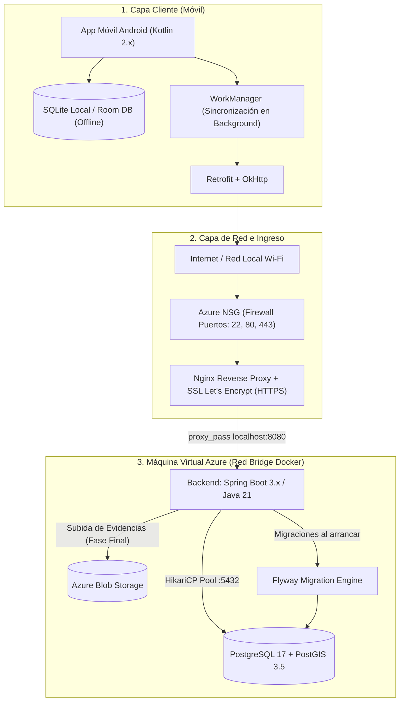
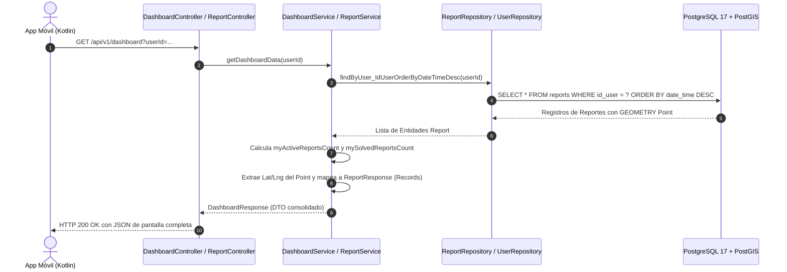
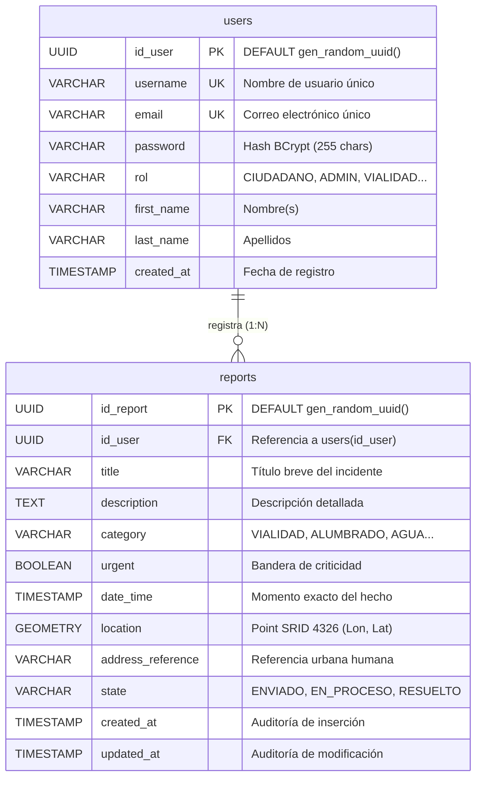
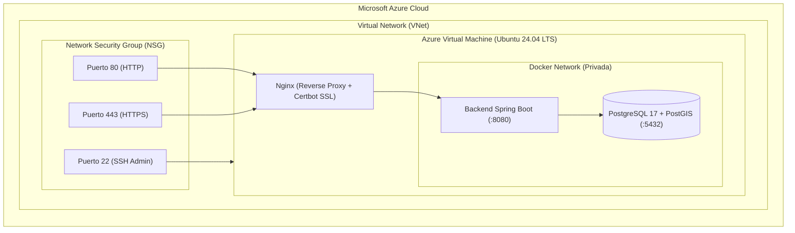

# AlertCity - Documento Maestro de Arquitectura de Software e Infraestructura

Este documento describe de manera exhaustiva la **arquitectura técnica integral de AlertCity**, cubriendo el estado actual (orientado a desarrollo y entrega de la Demo) y el estado futuro (producto final escalable y desplegado en producción en la nube de Microsoft Azure).

---

## 1. Visión y Objetivos Arquitecturales

AlertCity es una plataforma cívica colaborativa donde los ciudadanos registran incidencias urbanas (baches, fallas de alumbrado, fugas de agua, drenaje colapsado, seguridad, etc.) para que las dependencias municipales prioricen y resuelvan problemáticas públicas.

### Atributos de Calidad del Sistema:
1. **Resiliencia (Arquitectura Offline-First):** La aplicación móvil debe permitir el levantamiento de reportes y captura de coordenadas aun en zonas urbanas o rurales sin cobertura de datos móviles, garantizando sincronización automática al recuperar señal.
2. **Eficiencia Geoespacial (PostGIS):** Capacidad de almacenar coordenadas con estándar cartográfico internacional y resolver consultas espaciales complejas (como encontrar reportes a menos de $X$ km o dentro de una colonia) en milisegundos mediante índices GiST.
3. **Desacoplamiento y Portabilidad (Docker):** El entorno de ejecución está estandarizado en contenedores, permitiendo que la misma solución corra idéntica en la computadora del desarrollador y en un servidor Linux en la nube.
4. **Seguridad y Privacidad:** Protección de contraseñas con algoritmos modernos (BCrypt), comunicación cifrada mediante HTTPS/TLS, autenticación stateless con JWT y aislamiento de la base de datos en redes privadas de Docker.

---

## 2. Visión Global: Arquitectura Actual vs. Arquitectura Futura



### Cuadro Comparativo de Evolución:

| Dimensión | Fase Actual (Demo Local) | Fase Futura (Producción en Azure) |
| :--- | :--- | :--- |
| **Infraestructura** | Computadora local (Windows 11) en LAN Wi-Fi. | Máquina Virtual Linux (Ubuntu Server 24.04 LTS) en Azure. |
| **Protocolo HTTP** | HTTP plano (`http://192.168.1.6:8080`) con `usesCleartextTraffic`. | HTTPS seguro (`https://api.alertcity.app`) con certificado SSL Let's Encrypt. |
| **Seguridad de Red** | Puerto 8080 y 5432 expuestos a la máquina host. | Solo puertos 80 y 443 expuestos a internet; la BD solo escucha en la red privada interna de Docker. |
| **Autenticación** | Acceso abierto para demo (`permitAll`) y usuario simulado. | Spring Security + JWT Stateless (Access Token 1h + Refresh Token 30d) con RBAC. |
| **Manejo de Fotos** | URL simulada / mock o placeholder estático local. | Carga binaria `multipart/form-data` almacenada en Azure Blob Storage con URLs CDN seguras. |
| **Persistencia Móvil** | Petición directa a Retrofit. | Arquitectura Offline-First con Room DB + cola de subida con WorkManager. |
| **Consultas Espaciales**| Búsqueda y listado cronológico de reportes. | Consultas por radio de proximidad con `ST_DWithin` y clusters para mapas interactivos. |

---

## 3. Arquitectura del Backend (Spring Boot + Java 21)

El backend sigue una **Arquitectura en Capas Limpias (Clean / Layered Architecture)** combinada con el patrón **BFF (Backend for Frontend)** para optimizar la comunicación con la aplicación móvil.

```
com.AlertCity_Backend
├── config/                 # Configuración de Seguridad, CORS, PostGIS GeometryFactory
├── controller/             # Controladores REST (Mapeo HTTP, Códigos de Estado, Validación)
├── dto/                    # Data Transfer Objects (Java 21 Records inmutables)
├── model/                  # Entidades JPA del Dominio (User, Report, Enums)
├── repository/             # Interfaces Spring Data JPA con consultas derivadas y espaciales
└── service/                # Capa de Negocio (Lógica, Cálculos, Mapeo Geoespacial)
```

### 3.1. Flujo de Datos y Responsabilidades de las Capas



### 3.2. Patrón BFF (Backend for Frontend) en el Dashboard
En lugar de forzar a la aplicación móvil a realizar múltiples viajes de ida y vuelta para consultar contadores, reportes propios y reportes generales, el endpoint **`GET /api/v1/dashboard`** consolida el estado completo:
- **`myActiveReportsCount`**: Total de incidencias no resueltas del usuario en sesión.
- **`mySolvedReportsCount`**: Total de incidencias atendidas del usuario en sesión.
- **`myReports`**: Lista de reportes del ciudadano ordenados cronológicamente.
- **`allReports`**: Feed comunitario de toda la ciudad.

### 3.3. DTOs Inmutables con Java 21 Records
Se eliminó la necesidad de frameworks pesados de generación de código como Lombok mediante **Java 21 Records**. Los records garantizan:
- Inmutabilidad estricta (atributos `final` y libres de efectos secundarios).
- Serialización y deserialización automática y ultrarrápida con Jackson.
- Separación tajante entre la entidad de persistencia (`Report`) y lo que viaja por internet (`ReportResponse`).

### 3.4. Manejo de Seguridad (Actual vs. Futuro)
- **Fase Actual (Demo):** Se requiere una clase `SecurityConfig` que desactive CSRF y declare `requestMatchers("/api/v1/**").permitAll()` para permitir pruebas inmediatas desde el celular sin credenciales complejas.
- **Fase Futura (JWT + RBAC):**
  - Implementación de `JwtAuthenticationFilter` (extiende `OncePerRequestFilter`).
  - Intercepción de cabecera `Authorization: Bearer <token>`.
  - Roles jerárquicos:
    - `ROLE_CITIZEN`: Puede crear reportes, ver sus propios reportes y consultar el mapa público.
    - `ROLE_OPERATOR`: Puede consultar reportes de su área (ej. `VIALIDAD`, `AGUA`) y cambiar el estado (`EN_PROCESO`, `RESUELTO`).
    - `ROLE_ADMIN`: Acceso a métricas globales, auditoría y gestión de usuarios.

---

## 4. Arquitectura de Persistencia y Geoespacial (PostgreSQL + PostGIS)

PostgreSQL combinado con **PostGIS** es el estándar de la industria para sistemas de información geográfica (GIS), utilizado por aplicaciones de escala masiva como Uber o Mapbox.



### 4.1. El Tipo de Dato Espacial y la Proyección SRID 4326
- La columna `location` utiliza el tipo nativo `GEOMETRY(Point, 4326)`.
- El código numérico **4326** corresponde a la proyección **WGS 84 (World Geodetic System 1984)**, que es el estándar universal empleado por los receptores GPS de los teléfonos Android.
- **Regla Cartográfica Fundamental:** En sistemas GIS formales y funciones de PostGIS (`ST_MakePoint`, `ST_Point`), el orden de coordenadas es siempre **$(X, Y) = (\text{Longitud}, \text{Latitud})$**:
  ```sql
  -- Ejemplo de inserción en PostGIS:
  -- Longitud X: -101.1923 (Oeste de Greenwich)
  -- Latitud Y:   20.1458 (Norte del Ecuador)
  location = ST_SetSRID(ST_MakePoint(-101.1923, 20.1458), 4326)
  ```

### 4.2. Indexación Espacial GiST (Generalized Search Tree)
Para que el motor de base de datos no realice un escaneo secuencial tabla por tabla (*Full Table Scan*) al buscar incidentes cercanos, se definió un índice espacial **GiST**:
```sql
CREATE INDEX IF NOT EXISTS idx_reports_location ON reports USING GIST (location);
```
- **Cómo opera:** Organiza los puntos geográficos en un árbol jerárquico de rectángulos delimitadores mínimos (*Bounding Boxes / R-Tree*).
- **Rendimiento:** Permite resolver consultas de proximidad entre cientos de miles de registros en tiempo logarítmico $\mathcal{O}(\log N)$, ejecutando las búsquedas en fracciones de milisegundo.

### 4.3. Consultas Geoespaciales para la Fase Final

#### A. Búsqueda por Radio de Proximidad (ej. "Reportes a 3 km a la redonda"):
```sql
-- ST_DWithin con conversión a geography calcula distancias reales en metros
SELECT id_report, title, category,
       ST_Distance(location::geography, ST_SetSRID(ST_MakePoint(-101.1923, 20.1458), 4326)::geography) AS distancia_metros
FROM reports
WHERE ST_DWithin(
    location::geography,
    ST_SetSRID(ST_MakePoint(-101.1923, 20.1458), 4326)::geography,
    3000 -- Distancia en metros (3 km)
)
ORDER BY distancia_metros ASC;
```

#### B. Exportación Directa a GeoJSON para Mapas:
PostGIS puede generar GeoJSON nativo desde SQL, facilitando pintar capas vectoriales directamente en Android con Google Maps SDK o Mapbox:
```sql
SELECT json_build_object(
    'type', 'FeatureCollection',
    'features', json_agg(ST_AsGeoJSON(r.*)::json)
) FROM reports r;
```

---

## 5. Arquitectura de Contenerización con Docker

El proyecto implementa un desacoplamiento estricto mediante contenedores Docker para garantizar la portabilidad entre desarrollo y nube.

### 5.1. Dockerfile Multi-Stage Optimizado
El archivo [`Dockerfile`](file:///c:/Users/garci/Documentos/ITSUR/7%20Semestre/Programacion%20Movil/AlertCity-Backend/Dockerfile) reduce el tamaño final de la imagen y mejora la seguridad dividiendo el proceso en dos etapas:

```
[ Etapa 1: Builder (maven:3.9-eclipse-temurin-21) ]
  ├── Descarga dependencias offline
  ├── Compila el código Java 21
  └── Genera app.jar (Target)
           │
           │ Solo se transfiere el archivo JAR compilado
           ▼
[ Etapa 2: Runtime (eclipse-temurin:21-jre-alpine) ]
  ├── Imagen base ultraligera de Alpine Linux (~180 MB)
  ├── Crea usuario no-root 'spring' para evitar ejecución como root
  ├── Expone puerto 8080
  └── Inicia la JVM con flags de memoria adaptativa (-XX:MaxRAMPercentage=75.0)
```

### 5.2. Aislamiento de Red con Docker Compose
En [`docker-compose.yml`](file:///c:/Users/garci/Documentos/ITSUR/7%20Semestre/Programacion%20Movil/AlertCity-Backend/docker-compose.yml):
- Todos los servicios comparten una red interna privada bridge (`alertcity_default`).
- El backend se comunica con la base de datos a través del nombre de servicio DNS `db:5432`.
- El servicio `db` cuenta con un `healthcheck` que ejecuta `pg_isready`, impidiendo que el backend intente arrancar antes de que PostgreSQL esté 100% listo para recibir conexiones.

---

## 6. Proceso de Despliegue en Máquina Virtual de Azure

Esta sección describe el procedimiento paso a paso para llevar el backend de AlertCity a producción en **Microsoft Azure**.



### 6.1. Requisitos y Dimensionamiento en Azure
- **Tipo de Recurso:** Máquina Virtual Azure (IaaS).
- **Sistema Operativo:** Ubuntu Server 24.04 LTS (x64).
- **Tamaño recomendado:** `Standard_B2s` (2 vCPU, 4 GiB de RAM) o `Standard_B2als_v2`. Es suficiente para soportar la JVM de Spring Boot (1-1.5 GB), PostgreSQL/PostGIS (500 MB - 1 GB) y Nginx (< 100 MB).
- **Disco:** 30 a 64 GB SSD Premium administrado.

---

### 6.2. Configuración del Grupo de Seguridad de Red (Azure NSG)

> [!CAUTION]
> **Regla Crítica de Seguridad**: Jamás debes exponer el puerto 5432 de PostgreSQL hacia internet. La base de datos solo debe ser accesible desde adentro de la máquina virtual por la red interna de Docker.

Configura las siguientes **Reglas de Seguridad de Entrada (Inbound Security Rules)** en el portal de Azure:

| Prioridad | Nombre | Puerto | Protocolo | Origen | Acción | Propósito |
| :---: | :--- | :---: | :---: | :---: | :---: | :--- |
| **100** | `Allow-SSH` | `22` | TCP | Tu IP pública | **Allow** | Administración remota segura de la máquina virtual. |
| **110** | `Allow-HTTP` | `80` | TCP | Any (`*`) | **Allow** | Tráfico web estándar y validación de certificados SSL con Certbot. |
| **120** | `Allow-HTTPS` | `443` | TCP | Any (`*`) | **Allow** | Tráfico cifrado de la aplicación móvil hacia la API REST. |
| **65000** | `DenyAllInbound` | `*` | Any | Any (`*`) | **Deny** | Bloqueo por defecto de cualquier otro puerto no autorizado. |

---

### 6.3. Guía Paso a Paso de Instalación y Despliegue en el Servidor

#### Paso 1: Conexión SSH a la Máquina Virtual
```bash
ssh -i ~/.ssh/azure_alertcity_key.pem azureuser@<IP_PUBLICA_AZURE>
```

#### Paso 2: Actualización del Sistema e Instalación de Docker y Nginx
```bash
# Actualizar paquetes base
sudo apt update && sudo apt upgrade -y

# Instalar utilidades esenciales
sudo apt install -y ca-certificates curl gnupg lsb-release git nginx certbot python3-certbot-nginx

# Instalar repositorio oficial de Docker
sudo install -m 0755 -d /etc/apt/keyrings
curl -fsSL https://download.docker.com/linux/ubuntu/gpg | sudo gpg --dearmor -o /etc/apt/keyrings/docker.gpg
sudo chmod a+r /etc/apt/keyrings/docker.gpg

echo \
  "deb [arch="$(dpkg --print-architecture)" signed-by=/etc/apt/keyrings/docker.gpg] https://download.docker.com/linux/ubuntu \
  "$(. /etc/os-release && echo "$VERSION_CODENAME")" stable" | \
  sudo tee /etc/apt/sources.list.d/docker.list > /dev/null

sudo apt update
sudo apt install -y docker-ce docker-ce-cli containerd.io docker-buildx-plugin docker-compose-plugin

# Permitir uso de docker sin sudo
sudo usermod -aG docker $USER
newgrp docker
```

#### Paso 3: Clonar el Repositorio y Configurar Variables de Entorno
```bash
# Clonar código del backend
git clone https://github.com/tu-usuario/AlertCity-Backend.git
cd AlertCity-Backend

# Configurar el archivo .env de producción
nano .env
```
Contenido para producción en el `.env`:
```properties
DB_HOST=db
DB_PORT=5432
DB_USER=alertcity_admin
DB_PASSWORD=ContraseñaSuperSegura_Prod2026!
DB_NAME=alertcity_db
BACKEND_PORT=8080
```

#### Paso 4: Levantar los Contenedores con Docker Compose
```bash
# Compilar imagen y arrancar BD + Backend en modo detached
docker compose up -d --build

# Verificar que los contenedores estén sanos y corriendo
docker compose ps
docker compose logs backend --tail 30
```

#### Paso 5: Configurar Nginx como Reverse Proxy con Terminación SSL
Crea el archivo de configuración del sitio:
```bash
sudo nano /etc/nginx/sites-available/alertcity
```
Agrega la siguiente configuración:
```nginx
server {
    server_name api.alertcity.app; # O la IP pública si aún no tienes dominio

    client_max_body_size 25M; # Permite subida de fotos de alta resolución

    location / {
        proxy_pass http://127.0.0.1:8080;
        proxy_http_version 1.1;
        proxy_set_header Upgrade $http_upgrade;
        proxy_set_header Connection 'upgrade';
        proxy_set_header Host $host;
        proxy_set_header X-Real-IP $remote_addr;
        proxy_set_header X-Forwarded-For $proxy_add_x_forwarded_for;
        proxy_set_header X-Forwarded-Proto $scheme;
        proxy_cache_bypass $http_upgrade;
    }
}
```
Activa el sitio en Nginx:
```bash
sudo ln -s /etc/nginx/sites-available/alertcity /etc/nginx/sites-enabled/
sudo rm /etc/nginx/sites-enabled/default # Elimina el sitio por defecto
sudo nginx -t
sudo systemctl restart nginx
```

#### Paso 6: Obtener Certificado SSL Gratuito con Certbot (HTTPS)
```bash
# Solicita el certificado y configura automáticamente la redirección HTTPS en Nginx
sudo certbot --nginx -d api.alertcity.app
```
*(Certbot añadirá automáticamente la renovación automática del certificado mediante un cron interno).*

---

### 6.4. Política de Respaldos de la Base de Datos en Producción
Para prevenir pérdidas de datos ante cualquier desastre, se configura una tarea programada (*cron job*) que realiza un volcado diario de la base de datos con compresión:

```bash
# Abrir editor de tareas cron
crontab -e
```
Agregar la siguiente línea para respaldar todos los días a las 3:00 AM:
```bash
0 3 * * * docker exec alertcity-db pg_dump -U alertcity_admin -d alertcity_db | gzip > /home/azureuser/backups/alertcity_$(date +\%F).sql.gz
```

---

## 7. Integración con la App Móvil (Estrategia Offline-First)

La arquitectura de la aplicación en Kotlin se apoya en el patrón de repositorio con **Single Source of Truth**:

```
[ Pantalla de Reportes (UI Compose) ]
                  │ Observa StateFlow
                  ▼
[ Repositorio Móvil (ReportRepository.kt) ]
                  │
        ┌─────────┴─────────┐
        ▼                   ▼
 [ Room Database ]   [ Remote API (Retrofit) ]
 (Caché Offline)     (Spring Boot en Azure)
```

1. **Lectura:** La pantalla móvil **siempre lee de Room**. Si no hay internet, el usuario sigue viendo todos los reportes previamente descargados sin bloqueos ni errores.
2. **Escritura:** Al crear un reporte, se inserta en Room con estado `SYNC_PENDING` y se encola una tarea en **WorkManager**.
3. **Disparador:** WorkManager monitorea el estado del hardware de red (`NetworkCapabilities.NET_CAPABILITY_INTERNET`). En cuanto el dispositivo se conecta a WiFi o datos móviles, despacha la petición `POST /api/v1/reports`, actualiza el registro en Room a `SYNCED` y notifica a la interfaz de usuario.
