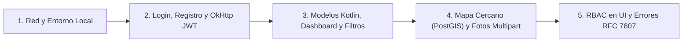

# Plan de Integración Frontend (Android / Kotlin) — AlertCity Etapa 2

Este documento guía al equipo de **Frontend (Android / Kotlin)** para integrar la aplicación móvil con las nuevas capacidades de producción de la **Etapa 2** del backend, especificadas en [`API_CONTRACTS.md`](file:///c:/Users/garci/Documentos/ITSUR/7%20Semestre/Programacion%20Movil/AlertCity-Backend/Documentation/API_CONTRACTS.md) y [`LOCAL_TESTING_GUIDE.md`](file:///c:/Users/garci/Documentos/ITSUR/7%20Semestre/Programacion%20Movil/AlertCity-Backend/Documentation/LOCAL_TESTING_GUIDE.md).

---

## Cambios Clave respecto a la Etapa 1 (Demo)

| Aspecto | Etapa 1 (Demo) | Etapa 2 (Actual) |
| :--- | :--- | :--- |
| **Autenticación** | Abierta (`permitAll()`) con `userId` fijo. | Obligatoria vía **JWT** (`Authorization: Bearer <accessToken>`). |
| **Identidad del Usuario** | Se enviaba `userId` manualmente. | El backend deduce el usuario desde el token JWT. |
| **Evidencia Fotográfica** | Placeholder local / URL simulada. | Subida real `multipart/form-data` en `POST /api/v1/reports/{id}/media` y campo `imageUrl` en `ReportResponse`. |
| **Mapas y Búsquedas** | Listado completo `GET /api/v1/reports`. | Búsqueda por radio PostGIS (`/nearby`), filtros dinámicos y paginación (`/page`). |
| **Errores de API** | Genéricos. | Estándar **RFC 7807 (`ProblemDetail`)** con `title`, `status`, `detail` y `errors`. |

---

## Hoja de Ruta de Integración (5 Fases)

### Fase 1: Preparación de Red y Entorno Local
1. **Confirmar que el Backend está arriba** (Docker Desktop + `docker compose up -d` o desde IntelliJ en puerto `8080`).
2. **Validar acceso desde el dispositivo/emulador** abriendo `http://<IP_PC>:8080/actuator/health` (debe responder `{"status":"UP"}`) y explorar contratos en `http://<IP_PC>:8080/swagger-ui.html`.
3. **Configurar `baseUrl` de Retrofit:**
   - **Dispositivo físico (mismo Wi-Fi):** `http://<IP_LOCAL_PC>:8080/` (ej. `http://192.168.1.6:8080/`).
   - **Emulador de Android Studio:** `http://10.0.2.2:8080/`.
4. **Permisos y tráfico HTTP en `AndroidManifest.xml`:**
   - Mantener `android:usesCleartextTraffic="true"` mientras se pruebe en HTTP local.
   - Permisos requeridos: `INTERNET`, `ACCESS_FINE_LOCATION`, `ACCESS_COARSE_LOCATION`.

---

### Fase 2: Autenticación JWT y Renovación Silenciosa (OkHttp)
1. **Copiar los nuevos DTOs** de [`API_CONTRACTS.md`](file:///c:/Users/garci/Documentos/ITSUR/7%20Semestre/Programacion%20Movil/AlertCity-Backend/Documentation/API_CONTRACTS.md#L213-L295): `LoginRequest`, `RegisterRequest`, `RefreshTokenRequest` y `AuthResponse`.
2. **Crear gestor de sesión local** (usando `EncryptedSharedPreferences` o `DataStore`) para guardar:
   - `accessToken`, `refreshToken`, `userId`, `username`, `rol`.
3. **Implementar pantallas de Login y Registro:**
   - `POST /api/v1/auth/login` (acepta username o email).
   - `POST /api/v1/auth/register` (crea usuarios con rol `CIUDADANO`).
   - **Cuentas semilla listas para probar** (contraseña `"password"` para todas):
     - Ciudadana: `laura_ciudadana` (`CIUDADANO`)
     - Operador Vialidad: `carlos_vialidad` (`VIALIDAD`)
     - Operador Agua: `roberto_agua` (`AGUA_DRENAJE`)
     - Operador Alumbrado: `maria_alumbrado` (`ALUMBRADO`)
4. **Configurar `OkHttpClient` con Interceptor + Authenticator:**
   - **`Interceptor`**: Inyecta `Authorization: Bearer <accessToken>` en todas las peticiones excepto `/api/v1/auth/**`.
   - **`Authenticator` (Refresh silencioso):** Ante un `401 Unauthorized`, llama síncronamente a `POST /api/v1/auth/refresh` con el `refreshToken`, actualiza los tokens guardados y reintenta la petición original. Si el refresh falla, cierra la sesión y navega al Login.

---

### Fase 3: Actualización de Modelos, Dashboard y Filtros
1. **Actualizar `ReportResponse`** agregando `val imageUrl: String?`.
2. **Simplificar `CreateReportRequest`:**
   - `userId` puede enviarse como `null` (el backend lo extrae del JWT).
   - Eliminar el campo `state` del request (el backend asigna `ENVIADO` por defecto).
3. **Simplificar `getDashboard()`:**
   - Llamar a `GET /api/v1/dashboard` sin query param `userId`; el backend devolverá `myActiveReportsCount`, `mySolvedReportsCount`, `myReports` y `allReports` del usuario autenticado.
4. **Conectar filtros y paginación:**
   - Listado filtrado: `GET /api/v1/reports?category=...&state=...&urgent=...&fromDate=...&toDate=...`
   - Listado paginado (scroll infinito): `GET /api/v1/reports/page?page=0&size=10&sort=dateTime,desc`

---

### Fase 4: Consultas Geoespaciales (PostGIS) y Evidencias Fotográficas
1. **Mapa de incidencias cercanas:**
   - Al abrir el mapa con la ubicación GPS actual, consumir `GET /api/v1/reports/nearby?lat=<lat>&lng=<lng>&radiusKm=3.0`.
   - El backend devuelve los reportes dentro del radio ordenados del más cercano al más lejano.
2. **Subida de foto al crear un reporte (flujo en 2 pasos):**
   - **Paso 1:** Enviar `POST /api/v1/reports` con el JSON del reporte $\to$ obtener `reportId` (`201 Created`).
   - **Paso 2:** Si el usuario seleccionó o tomó una foto, comprimirla (JPEG/PNG/WebP, máx. `10 MB`) y enviarla a `POST /api/v1/reports/{id}/media` como `MultipartBody.Part` con nombre `"file"`.
3. **Visualización de imágenes:**
   - Cuando `report.imageUrl != null`, construir la URL completa concatenando el host base (sin `api/v1/`) + `imageUrl`, por ejemplo: `http://192.168.1.6:8080/uploads/reports/<archivo>.jpg`, y cargarla con Coil o Glide.

---

### Fase 5: Control de Roles (RBAC) y Manejo de Errores RFC 7807
1. **UI condicional según `AuthResponse.rol`:**
   - Si `rol == "CIUDADANO"`, mostrar el estado del reporte como solo lectura.
   - Si `rol` es `ADMIN` o un rol operativo (`VIALIDAD`, `ALUMBRADO`, `AGUA_DRENAJE`, `LIMPIEZA`, `SEGURIDAD`, `AREAS_VERDES`, `ANIMALES`), habilitar el botón para cambiar el estado mediante `PATCH /api/v1/reports/{id}/state` (`ENVIADO`, `EN_PROCESO`, `RESUELTO`).
   - *(Nota: un operador operativo solo puede cambiar el estado de reportes de su propia categoría; de lo contrario el backend responde `403 Forbidden`).*
2. **Parseo de errores RFC 7807 (`ProblemDetail`):**
   - Crear una data class `ApiErrorResponse(val title: String?, val status: Int?, val detail: String?, val errors: Map<String, String>?)` para leer `response.errorBody()` y mostrar mensajes claros al usuario (ej. errores de validación campo por campo en `400`, credenciales inválidas en `401`, duplicados en `409`).

---

## Checklist de Validación Conjunta (Backend $\leftrightarrow$ Móvil)

- [ ] Login exitoso con `laura_ciudadana` / `password` y persistencia del token.
- [ ] Carga de `GET /api/v1/dashboard` con header `Authorization: Bearer ...`.
- [ ] Creación de reporte con coordenadas GPS reales (`POST /api/v1/reports`).
- [ ] Subida de foto JPEG/PNG (`POST /api/v1/reports/{id}/media`) y renderizado en pantalla desde `/uploads/reports/...`.
- [ ] Consulta de reportes cercanos (`GET /api/v1/reports/nearby`) pintando marcadores en el mapa.
- [ ] Cambio de estado (`PATCH /api/v1/reports/{id}/state`) validado con un usuario operador (ej. `carlos_vialidad`) y bloqueo `403` verificado con `CIUDADANO`.
